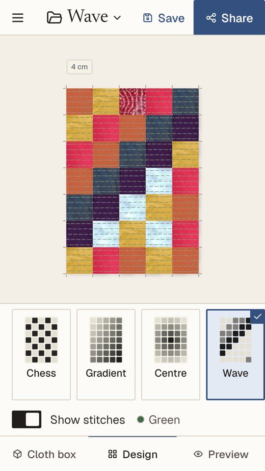
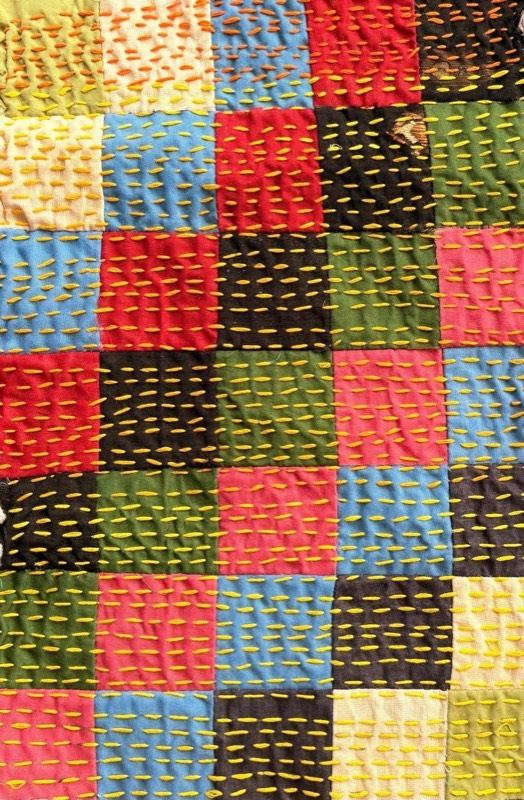
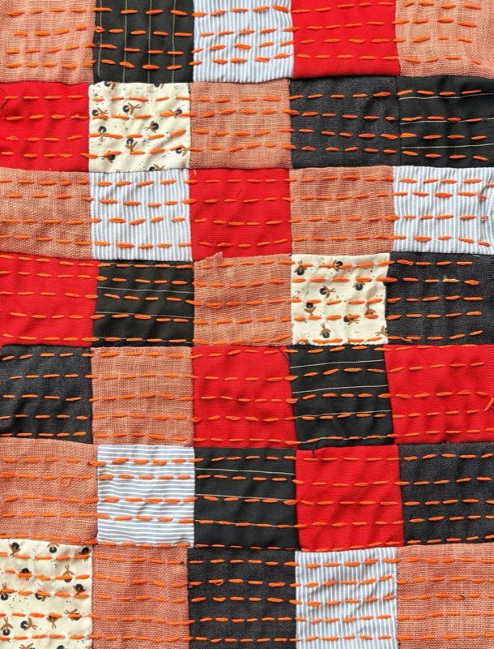

# Kantha studio


**[kantha.app](https://kantha.app)** · [Open the studio](https://kantha.app/studio) · [Help](https://kantha.app/help)

A kantha panel is 35 squares of salvaged cloth, 4 cm each, sewn into a grid. Deciding which square goes
where takes an afternoon. The Kantha studio is the app that does the deciding. It runs on the web at
[kantha.app/studio](https://kantha.app/studio), and on Android and iPhone.



 

## What it does

Collect scraps of cloth, cut them 6 × 6 cm, photograph them into a box, and see designs come out of what
you already had at home. Print the sheet and stitch it yourself, or with friends.

Nobody signs in. The studio starts on a Sample box of real cloth, already arranged. You add a box and
photograph your own cloth into it, and the studio arranges that too. It fills one of 15 patterns from a
box, shows it plain, framed or on a tote bag, and makes a true-size PDF to print and a photo to share.

Everything stays on the device: boxes, photos and designs live in a database in the app. Back up, in the
Menu, saves them as one file that can be opened on another device. Nothing is sent anywhere.

## Where things are

| Path | What it holds |
|---|---|
| `studio/` | The studio: one Flutter app for Android, iPhone and the web. The solver, colour measuring, the PDF and the photo all run on the device. |
| `studio/lib/solver/` | Geometry, patterns, colour and the pattern solver. No network, no database. |
| `studio/integration_test/` | The whole journey, and a backup moved, run in Chrome, a simulator or an emulator. |
| `messages/en.json` | Every word the studio shows. |
| `docs/translating.md` | How to translate the studio. |

## Running it

You need Flutter 3.47.6. In `studio/`:

```bash
flutter pub get
flutter run -d chrome    # or a simulator or emulator from `flutter devices`
flutter analyze
flutter test --exclude-tags pixels
./tool/build_web.sh      # the web build, into build/web
```

`CONTRIBUTING.md` has the whole list of checks, including the journeys in Chrome.

## Where the words live

Every word a person reads in the studio is in `messages/en.json`. The studio's word files
(`studio/lib/l10n/`) are made from it by `studio/tool/l10n_from_messages.dart`. Change words there, not
in the code.

## The numbers that are fixed

A piece is cut at **6 cm** square and finishes at **4 cm**. The 2 cm difference is the seam allowance.
They are `cutCm` and `patchCm` in `studio/lib/solver/geometry.dart`. A panel is 5 × 7 pieces.

## Contributing

Read `CONTRIBUTING.md` before you write code: open an issue with your proposal first. To report a security
problem, read `SECURITY.md`.

## Licences

- The code is under the Apache License 2.0: `LICENSE` and `NOTICE`.
- The cloth photos, the K icon and the screenshots are under CC BY 4.0: `ASSETS-LICENSE.md`.
- The fonts are under the SIL Open Font License, each with its own file in `studio/assets/fonts/`.
- The name Kantha and the K icon identify the official app: `TRADEMARKS.md`. A fork is published under
  another name and icon.
